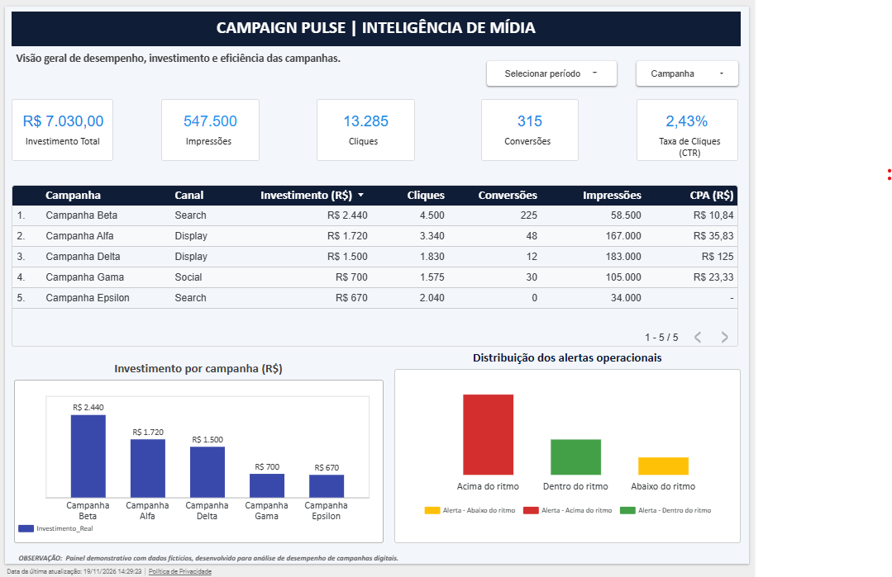

# 📊 Campaign Pulse | Digital Media Intelligence

**Business Intelligence • Performance Analysis • Digital Marketing**

Dashboard gerencial desenvolvido no Google Looker Studio para acompanhamento e análise de desempenho de campanhas de mídia digital.

O projeto demonstra a aplicação de conceitos de Business Intelligence na organização, visualização e interpretação de indicadores, proporcionando uma visão consolidada dos resultados das campanhas.

---

## 🎯 1. Contexto e objetivo do negócio

Em operações de marketing digital, acompanhar diferentes campanhas, canais e indicadores é fundamental para compreender o desempenho dos investimentos.

A proposta deste projeto é centralizar informações relevantes em um dashboard interativo, facilitando a análise comparativa das campanhas e a identificação de situações que merecem atenção.

**Objetivo:** disponibilizar uma visão gerencial e operacional que facilite o acompanhamento de resultados e apoie a análise de desempenho das campanhas.

## 📈 2. Indicadores de desempenho (KPIs)

O dashboard apresenta os seguintes indicadores:

| Indicador | Significado gerencial |
|---|---|
| Investimento | Volume financeiro aplicado nas campanhas |
| Impressões | Quantidade de exibições dos anúncios |
| Cliques | Interações realizadas com os anúncios |
| Conversões | Resultados de conversão registrados |
| CTR | Indicador de taxa de cliques |
| CPA | Indicador de custo por aquisição |

## 🔎 3. Análises disponíveis

O dashboard permite explorar diferentes perspectivas do desempenho das campanhas:

- **Visão consolidada:** acompanhamento dos principais indicadores.
- **Análise por campanha:** comparação de resultados e investimentos.
- **Análise por canal:** visualização de desempenho em Search, Display e Social.
- **Acompanhamento operacional:** distribuição de campanhas conforme classificação de ritmo.
- **Análise comparativa:** identificação de diferenças entre campanhas.

## ⚙️ 4. Recursos do dashboard

- Filtro por período.
- Filtro por campanha.
- Indicadores consolidados.
- Gráficos comparativos.
- Tabela de desempenho das campanhas.
- Visualização de alertas operacionais.

## 💡 5. Aplicação no negócio

As informações apresentadas podem apoiar gestores na investigação de questões como:

- Quais campanhas concentram maior volume de investimento?
- Como está distribuído o desempenho entre os canais?
- Quais campanhas merecem maior atenção operacional?
- Como os investimentos estão relacionados aos resultados registrados?
- Onde existem oportunidades para aprofundar a análise de desempenho?

## 🛠️ 6. Tecnologias e conhecimentos aplicados

**Ferramenta**
- Google Looker Studio

**Conhecimentos**
- Business Intelligence
- Análise de Dados
- Visualização de Dados
- Indicadores de Desempenho (KPIs)
- Análise de Performance
- Monitoramento Operacional

## 🖥️ 7. Demonstração do projeto

### Dashboard – Campaign Pulse

🔗 **[Acessar dashboard interativo no Google Looker Studio](https://datastudio.google.com/u/0/reporting/dc0094f6-be6b-44f3-80eb-96d0b377dd37/page/DOeBG)**

## 📌 8. Sobre os dados

Projeto demonstrativo desenvolvido com dados fictícios, com finalidade educacional e de composição de portfólio profissional.

Os indicadores e visualizações apresentados representam um cenário simulado de acompanhamento de campanhas digitais.

## 🧩 9. Competências demonstradas

O desenvolvimento do Campaign Pulse permitiu aplicar conhecimentos de Business Intelligence em diferentes etapas do processo analítico:

- **Business Intelligence:** organização de informações para acompanhamento gerencial.
- **Análise de Dados:** interpretação e comparação de indicadores de desempenho.
- **Google Sheets:** estruturação da base de dados, aplicação de fórmulas e regras de negócio.
- **Google Looker Studio:** integração direta com a fonte de dados, construção de dashboards e filtros interativos.
- **Indicadores de Desempenho (KPIs):** cálculo e acompanhamento de CTR, CPC, CPA e Pacing.
- **Análise Gerencial:** identificação de desvios, avaliação de resultados e elaboração de recomendações.
---
## 📚 10. Documentação do Projeto

Explore os detalhes técnicos e gerenciais do Campaign Pulse:

- 📊 [Análise de Negócio](ANALISE_DE_NEGOCIO.md) — interpretação dos resultados, identificação de oportunidades e recomendações gerenciais.
- 📘 [Dicionário de KPIs](DICIONARIO_DE_KPIS.md) — definições, fórmulas e regras de negócio dos indicadores.
- 🔄 [Fluxo de Dados](FLUXO_DE_DADOS.md) — arquitetura e integração entre Google Sheets e Google Looker Studio.
  
**Projeto de portfólio | Business Intelligence | 2026**
